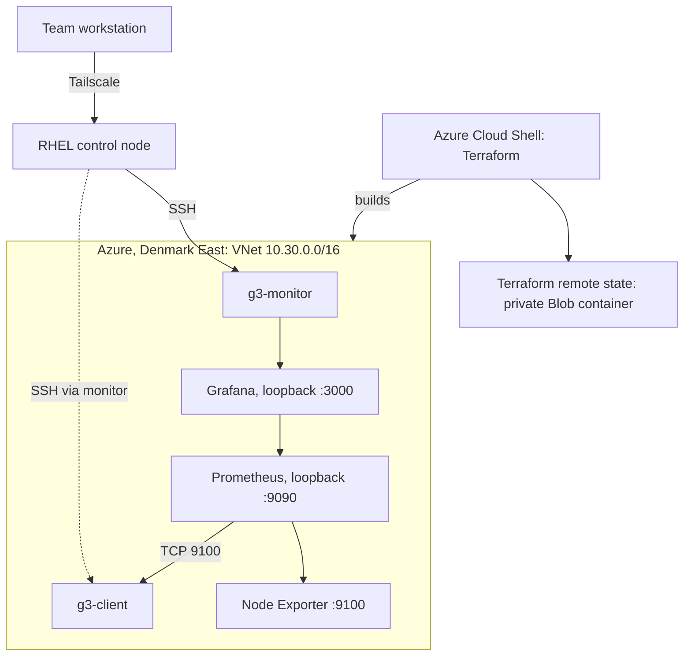

# NSSA 320 Final — Monitoring and Incident Response Platform

**Group 3:** Nick Prokhorenko, Kevin McCarthy, Miller Swank, Jesse Saunders

## Overview

Two Ubuntu VMs run in Azure: a monitor VM responsible for observation and a client VM that serves as the monitored host. Both run Node Exporter, which exposes basic system metrics such as CPU and memory usage. Prometheus runs on the monitor VM and collects these metrics from both machines every 15 seconds, where Grafana then presents them on a single dashboard.

If the exporter on the client VM stops responding for one minute, Prometheus fires an alert, and an Ansible playbook then runs to restart the exporter and verify that its metrics are being collected again. The environment is provisioned with Terraform for the Azure resources and configured with Ansible for the software on the VMs, so it can be rebuilt from this repository at any time.

## Architecture

The infrastructure consists of two virtual machines in a private Azure network, along with the lab systems used to build and manage them. The monitor VM runs the monitoring software, while the client VM acts as a typical server being monitored by an administrator. In this scenario only the monitor VM has a public IP address, and the client VM can only be reached through it, keeping the monitored machine off the internet.



**Monitoring:** Node Exporter runs on both VMs and publishes system metrics such as CPU and memory usage. Prometheus, on the monitor VM, collects those metrics every 15 seconds and stores them for seven days, and Grafana displays them on a dashboard.

**Alerting:** If the client VM stops answering for one minute, Prometheus fires the ***NodeExporterDown*** alert, and an Ansible playbook can then restart the exporter.

**Access:** Grafana and Prometheus listen only on the monitor VM, so they are viewed through SSH tunnels from the user's computer, by way of the RHEL control node. The client VM is reached by jumping through the monitor.

**Provisioning:** Terraform creates the Azure resources from Cloud Shell, and Ansible, run from the RHEL control node, installs and configures the monitoring software on the VMs.

### Dashboard panels

The Grafana dashboard,contains three panels, which are described below:

| Panel | Description |
| --- | --- |
| Node Availability | Shows whether each VM is currently reporting metrics to Prometheus |
| CPU Utilization | Shows the percentage of CPU in use on each VM |
| Memory Utilization | Shows the percentage of memory in use on each VM |

## Repository layout

| Path | Purpose |
| --- | --- |
| ***terraform/*** | Azure infrastructure and remote-state backend |
| ***ansible/site.yml*** | Full deployment |
| ***ansible/recovery.yml*** | Restart Node Exporter on the client and verify it |
| ***ansible/group_vars/all.yml*** | Shared monitoring configuration |
| ***ansible/roles/common/*** | Baseline packages and UFW |
| ***ansible/roles/node_exporter/*** | Metrics exporter |
| ***ansible/roles/prometheus/*** | Scrape config and alert rules |
| ***ansible/roles/grafana/*** | Data source and dashboard |
| ***scripts/generate_inventory.py*** | Terraform outputs to Ansible inventory |
| ***tests/health_check.sh*** | Read-only platform health check |
| ***tests/incident_test.sh*** | Automated outage simulation with measured timings |
| ***tests/incident_test_selftest.sh*** | Self-test for the incident script, no lab access needed |
| ***docs/evidence/*** | Logs and screenshots from deployment and testing |

## Deploying and operating

The following commands are run on the RHEL control node from the ***ansible/*** directory:

```bash
ansible-galaxy collection install -r requirements.yml
ansible all -m ping
ansible-playbook site.yml --syntax-check
ansible-playbook site.yml
```

A second run of ***site.yml*** should report ***changed=0***, which confirms that the deployment is idempotent and that nothing was left half-finished.

Terraform is run from Azure Cloud Shell rather than the control node. State files, saved plans, ***.tfvars*** files, generated inventories and private keys must never be committed, and Terraform applies and Ansible changes should not be run at the same time.

## Health check

***tests/health_check.sh*** is read-only. It verifies that the VMs and services are running, that all three Prometheus targets are healthy, and that the alert rule is loaded and not firing, and it exits with an error if any check fails.

```bash
./tests/health_check.sh | tee docs/evidence/health-check-$(date -u +%Y%m%dT%H%M%SZ).txt
```

## Incident simulation

***tests/incident_test.sh*** simulates an outage by stopping Node Exporter on ***g3-client***, waiting for the alert to fire, running ***ansible/recovery.yml***, and then waiting for the target to recover and the alert to clear. It finishes by printing a timeline and a short record suitable for the Azure Boards incident item, and the exporter is always restarted before the script exits.

The test causes a real outage, so a test window should be scheduled and the incident work item created beforehand.

```bash
./tests/incident_test.sh --check     # preflight only, changes nothing
./tests/incident_test.sh             # asks for confirmation, then runs
./tests/incident_test.sh --evidence  # also saves output to docs/evidence/
```

Timings are measured by polling every 5 seconds and are therefore accurate to within about 5 seconds. The script's logic can be checked without touching any VM by running ***./tests/incident_test_selftest.sh***.

To recover manually, run ***ansible-playbook recovery.yml*** from ***ansible/***, or run ***ssh g3-client 'sudo systemctl start prometheus-node-exporter'***.

## Cost estimates
 
The platform was deployed in Denmark East using ***Standard_B2s*** (monitor) and ***Standard_B1ms*** (client), but Azure does not publish a public price for these sizes in that region. The estimates below start from the published East US pay-as-you-go Linux rates and apply a 19.8% markup, which is the average difference observed between the Denmark and East US prices of the B-series sizes compared. Costs are shown per hour, with a total for the 80 powered-on hours planned for each VM.
 
| Item | East US (per hour) | Denmark East, estimated (per hour) | 80 hours |
| --- | --- | --- | --- |
| Monitor compute (***Standard_B2s***) | $0.0416 | $0.0498 | $3.99 |
| Client compute (***Standard_B1ms***) | $0.0207 | $0.0248 | $1.98 |
| Two OS disks | | $0.0137 | $1.10 |
| One public IP | | $0.0068 | $0.55 |
| Total | | $0.0952 | $7.61 |
 
The disk and public IP rates are planning allowances carried over from the proposal and do not include the Denmark markup. Taxes, network egress and storage account usage are not included.
